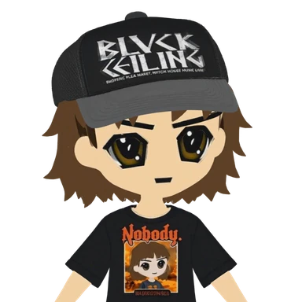
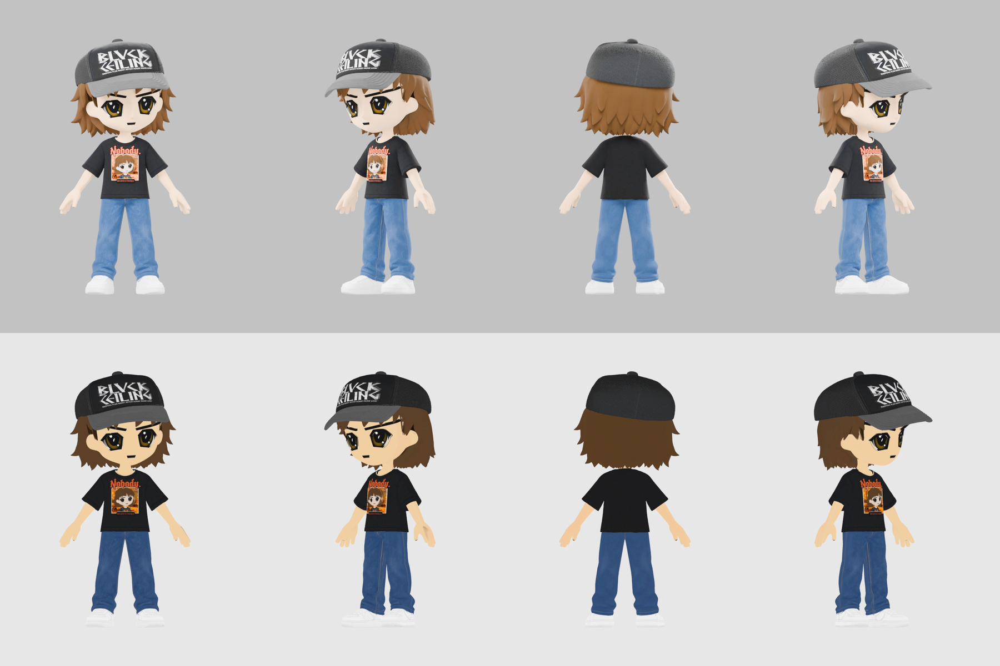

# radbro #96 · blvck ceiling

- worn dark charcoal "BLVCK CEILING" trucker cap with a black mesh back, shaggy chestnut hair, big olive-brown anime eyes, thick angled brows, black "Nobody." tee with the little chibi picture.
- the nft is a bust, so the lower body was designed to match: mid-blue jeans and white sneakers.
- the cap is part of the mesh and follows the Head bone, so it can't be removed. it counts toward his height.
- hands open and empty. parent props to RightHand.
- same proportions as the other radbros. the small print on the cap and the tee is soft at web resolution.

## files here

| file | what |
|---|---|
| `radbro96_web.glb` | mesh, skeleton and 4 clips: Casual_Walk, Run_02, Lean_Forward_Sprint, Regular_Jump. draco-compressed (needs a draco decoder), unlit, 1024 webp texture. 596,880 bytes (0.60 MB) |
| `radbro96_clips_web.glb` | skeleton only, no mesh; 10 clips: Idle, Big_Wave_Hello, Victory_Cheer, Rope_Hang_Idle, Grab_Bar_and_Swing_Forward, Falling_Down, Fishing_Cast, Waltz, Free_Fall, Big_Land. 670,460 bytes (0.67 MB) |
| `preview_radbro96.png` | turnaround. studio-lit on top, true flat colours below. 1,025,485 bytes |
| `portrait_radbro96.webp` | 384px head and shoulders, transparent. 25,004 bytes |

load `_clips_web.glb` next to `_web.glb` and play its clips on that character. they bind by bone name.

## full quality

[radbro96-3d-model.zip](https://github.com/dexedrne/radbros-3d/releases/download/v1/radbro96-3d-model.zip) has him with all 14 clips in one file, a rigged rest-pose file and a static mesh (8.79 MB).

- 1.78 m tall including the cap, metres, y-up, facing +z, origin between the feet
- 62,058 triangles, 2048 colour map (also wired to emissive for the flat look)
- 24-bone mixamo-style rig, same bone names as the other six. no finger bones
- the static file is also 1.78 m tall and grounded; the rigged files are the ones to use in a game

## license

[Viral Public License](../LICENSE). original character by [Radbro Webring](https://radbro.xyz), 3d model by dexedrne.
